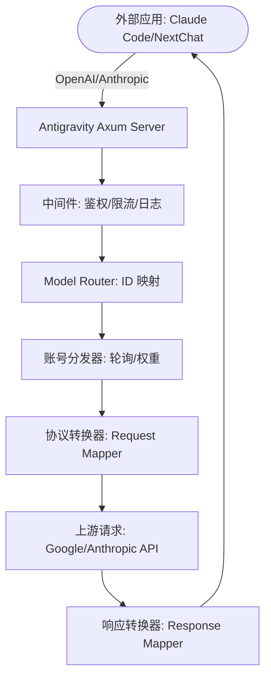

# Antigravity Tools 🚀
> 专业级 AI 账号管理与协议代理系统 (v4.5.1)
<div align="center">
  

  <h3>您的个人高性能 AI 调度网关</h3>
  <p>不仅仅是账号管理，更是打破 API 调用壁垒的终极解决方案。</p>
  
  <p>
    <a href="https://github.com/lbjlaq/Antigravity-Manager">
      
    </a>
    
    
    
    
  </p>

  <p>
    <a href="#-核心功能">核心功能</a> • 
    <a href="#-界面导览">界面导览</a> • 
    <a href="#-技术架构">技术架构</a> • 
    <a href="#-安装指南">安装指南</a> • 
    <a href="#-快速接入">快速接入</a>
  </p>

  <p>
    <strong>简体中文</strong> | 
    <a href="./README_EN.md">English</a>
  </p>
</div>

---

**Antigravity Tools** 是一个专为开发者和 AI 爱好者设计的全功能桌面应用。它将多账号管理、协议转换和智能请求调度完美结合，为您提供一个稳定、极速且成本低廉的 **本地 AI 中转站**。

通过本应用，您可以将常见的 Web 端 Session (Google/Anthropic) 转化为标准化的 API 接口，消除不同厂商间的协议鸿沟。

## 💖 赞助商 (Sponsors)

| 赞助商 (Sponsor) | 简介 (Description) |
| :---: | :--- |
|  | 感谢 **PackyCode** 对本项目的赞助！PackyCode 是一家可靠高效的 API 中转服务商，提供 Claude Code、Codex、Gemini 等多种服务的中转。PackyCode 为本项目的用户提供了特别优惠：使用[此链接](https://www.packyapi.com/register?aff=Ctrler)注册，并在充值时输入 **“Ctrler”** 优惠码即可享受 **九折优惠**。 |
|  | 感谢 APIKEY.FUN 赞助本项目！APIKEY.FUN 是一家专业的企业级 AI 中转站，致力于为企业和个人开发者提供稳定、高效、低成本的 AI 模型 API 接入服务。平台支持 Claude、OpenAI、Gemini 等主流热门模型，价格低至官方原价的 7%。通过本项目[专属链接](https://apikey.fun/register?aff=Ctrler)注册，还可享受最高 **充值永久 95 折** 专属优惠。 |
|  | 感谢 **Claude API** 对本项目的支持！claudeapi.com 是一家走**官方与 AWS 渠道**接入的 **Claude API** 中转站，专注 Claude，主打高稳定、低延迟，完整支持 Claude Code。为本项目用户提供专属福利：通过[专属链接](https://console.claudeapi.com/register?source=antigravity)注册即送**免费测试额度，零门槛跑通**；充值再享 **95 折**专属优惠(联系客服）。 |
|  | 感谢 AICodeMirror 赞助了本项目！AICodeMirror 提供 Claude Code / Codex / Gemini CLI 官方高稳定中转服务，支持企业级高并发、极速开票、7×24 专属技术支持。 Claude Code / Codex / Gemini 官方渠道低至 3.8 / 0.2 / 0.9 折，充值更有折上折！AICodeMirror 为 Antigravity-Manager 的用户提供了特别福利，通过[此链接](https://aicodemirror.ai/register?invitecode=MV5XUM)注册的用户，可享受首充8折，企业客户最高可享 7.5 折！ |


### ☕ 支持项目 (Support)

如果您觉得本项目对您有所帮助，欢迎打赏作者！

<a href="https://www.buymeacoffee.com/Ctrler" target="_blank"></a>

| 支付宝 (Alipay) | 微信支付 (WeChat) | Buy Me a Coffee |
| :---: | :---: | :---: |
|  |  |  |

## 🚀 推荐项目 (Recommended Projects)

如果您喜欢本项目，可能也会对以下项目感兴趣：

*   **[Antigravity-Tools-LS](https://github.com/lbjlaq/Antigravity-Tools-LS)**: 专为 AI 协议设计的语言服务器 (LSP)，为您提供更智能的代码补全、诊断和协议调试体验。

## 🌟 深度功能解析 (Detailed Features)

### 1. 🎛️ 智能账号仪表盘 (Smart Dashboard)
*   **全局实时监控**: 一眼洞察所有账号的健康状况，包括 Gemini Pro、Gemini Flash、Claude 以及 Gemini 绘图的 **平均剩余配额**。
*   **最佳账号推荐 (Smart Recommendation)**: 系统会根据当前所有账号的配额冗余度，实时算法筛选并推荐“最佳账号”，支持 **一键切换**。
*   **活跃账号快照**: 直观显示当前活跃账号的具体配额百分比及最后同步时间。

### 2. 🔐 强大的账号管家 (Account Management)
*   **OAuth 2.0 授权（自动/手动）**: 添加账号时会提前生成可复制的授权链接，支持在任意浏览器完成授权；回调成功后应用会自动完成并保存（必要时可点击“我已授权，继续”手动收尾）。
*   **多维度导入**: 支持单条 Token 录入、JSON 批量导入（如来自其他工具的备份），以及从 V1 旧版本数据库自动热迁移。
*   **网关级视图**: 支持“列表”与“网格”双视图切换。提供 403 封禁检测，自动标注并跳过权限异常的账号。

### 3. 🔌 协议转换与中继 (API Proxy)
*   **全协议适配 (Multi-Sink)**:
    *   **OpenAI 格式**: 提供 `/v1/chat/completions` 端点，兼容 99% 的现有 AI 应用。
    *   **Anthropic 格式**: 提供原生 `/v1/messages` 接口，支持 **Claude Code CLI** 的全功能（如思思维链、系统提示词）。
    *   **Gemini 格式**: 支持 Google 官方 SDK 直接调用。
*   **智能状态自愈**: 当请求遇到 `429 (Too Many Requests)` 或 `401 (Expire)` 时，后端会毫秒级触发 **自动重试与静默轮换**，确保业务不中断。

### 4. 🔀 模型路由中心 (Model Router)
*   **系列化映射**: 您可以将复杂的原始模型 ID 归类到“规格家族”（如将所有 GPT-4 请求统一路由到 `gemini-3-pro-high`）。
*   **专家级重定向**: 支持自定义正则表达式级模型映射，精准控制每一个请求的落地模型。
*   **智能分级路由 (Tiered Routing)**: [新] 系统根据账号类型（Ultra/Pro/Free）和配额重置频率自动优先级排序，优先消耗高速重置账号，确保高频调用下的服务稳定性。
*   **后台任务静默降级**: [新] 自动识别 Claude CLI 等工具生成的后台请求（如标题生成），智能重定向至 Flash 模型，保护高级模型配额不被浪费。

### 5. 🎨 多模态与 Imagen 3 支持
*   **高级画质控制**: 支持通过 OpenAI `size` (如 `1024x1024`, `16:9`) 参数自动映射到 Imagen 3 的相应规格。
*   **超强 Body 支持**: 后端支持高达 **100MB** (可配置) 的 Payload，处理 4K 高清图识别绰绰有余。

## 📸 界面导览 (GUI Overview)

| | |
| :---: | :---: |
|  <br> 仪表盘 |  <br> 账号列表 |
|  <br> 关于页面 |  <br> API 反代 |
|  <br> 系统设置 | |

### 💡 使用案例 (Usage Examples)

| | |
| :---: | :---: |
|  <br> Claude Code 联网搜索 |  <br> Cherry Studio 深度集成 |
|  <br> Imagen 3 高级绘图 |  <br> Kilo Code 接入 |

## 🏗️ 技术架构 (Architecture)



##  安装指南 (Installation)

### 选项 A: 终端安装 (推荐)

#### 跨平台一键安装脚本

自动检测操作系统、架构和包管理器，一条命令完成下载与安装。

**Linux / macOS:**
```bash
curl -fsSL https://raw.githubusercontent.com/lbjlaq/Antigravity-Manager/main/install.sh | bash
```

**Windows (PowerShell):**
```powershell
irm https://raw.githubusercontent.com/lbjlaq/Antigravity-Manager/main/install.ps1 | iex
```

> **支持的格式**: Linux (`.deb` / `.rpm` / `.AppImage`) | macOS (`.dmg`) | Windows (NSIS `.exe`)
>
> **高级用法**: 安装指定版本 `curl -fsSL ... | bash -s -- --version 4.5.1`，预览模式 `curl -fsSL ... | bash -s -- --dry-run`

#### macOS - Homebrew
如果您已安装 [Homebrew](https://brew.sh/)，也可以通过以下命令安装：

```bash
# 1. 订阅本仓库的 Tap
brew tap lbjlaq/antigravity-manager https://github.com/lbjlaq/Antigravity-Manager

# 2. 安装应用
brew install --cask antigravity-tools
```

#### Arch Linux
您可以选择通过一键安装脚本或 Homebrew 进行安装：

**方式 1：一键安装脚本 (推荐)**
```bash
curl -sSL https://raw.githubusercontent.com/lbjlaq/Antigravity-Manager/main/deploy/arch/install.sh | bash
```

**方式 2：通过 Homebrew** (如果您已安装 [Linuxbrew](https://sh.brew.sh/))
```bash
brew tap lbjlaq/antigravity-manager https://github.com/lbjlaq/Antigravity-Manager
brew install --cask antigravity-tools
```

#### 其他 Linux 发行版
安装后会自动将 AppImage 添加到二进制路径并配置可执行权限。

### 选项 B: 手动下载
前往 [GitHub Releases](https://github.com/lbjlaq/Antigravity-Manager/releases) 下载对应系统的包：
*   **macOS**: `.dmg` (支持 Apple Silicon & Intel)
*   **Windows**: `.msi` 或 便携版 `.zip`
*   **Linux**: `.deb` 或 `AppImage`

### 选项 C: Docker 部署 (推荐用于 NAS/服务器)
如果您希望在容器化环境中运行，我们提供了原生的 Docker 镜像。该镜像内置了对 v4.0.2 原生 Headless 架构的支持，可自动托管前端静态资源，并通过浏览器直接进行管理。

```bash
# 方式 1: 直接运行 (推荐)
# - API_KEY: 必填。用于所有协议的 AI 请求鉴定。
# - WEB_PASSWORD: 可选。用于管理后台登录。若不设置则默认使用 API_KEY。
docker run -d --name antigravity-manager \
  -p 8045:8045 \
  -e API_KEY=sk-your-api-key \
  -e WEB_PASSWORD=your-login-password \
  -e ABV_MAX_BODY_SIZE=104857600 \
  -v ~/.antigravity_tools:/root/.antigravity_tools \
  lbjlaq/antigravity-manager:latest

# 忘记密钥？执行 docker logs antigravity-manager 或 grep -E '"api_key"|"admin_password"' ~/.antigravity_tools/gui_config.json

#### 🔐 鉴权逻辑说明
*   **场景 A：仅设置了 `API_KEY`**
    - **Web 登录**：使用 `API_KEY` 进入后台。
    - **API 调用**：使用 `API_KEY` 进行 AI 请求鉴权。
*   **场景 B：同时设置了 `API_KEY` 和 `WEB_PASSWORD` (推荐)**
    - **Web 登录**：**必须**使用 `WEB_PASSWORD`，使用 API Key 将被拒绝（更安全）。
    - **API 调用**：统一使用 `API_KEY`。这样您可以将 API Key 分发给成员，而保留密码仅供管理员使用。

#### 🆙 旧版本升级指引
如果您是从 v4.0.1 及更早版本升级，系统默认未设置 `WEB_PASSWORD`。您可以通过以下任一方式设置：
1.  **Web UI 界面 (推荐)**：使用原有 `API_KEY` 登录后，在 **API 反代设置** 页面手动设置并保存。新密码将持久化存储在 `gui_config.json` 中。
2.  **环境变量 (Docker)**：在启动容器时增加 `-e WEB_PASSWORD=您的新密码`。**注意：环境变量具有最高优先级，将覆盖 UI 中的任何修改。**
3.  **配置文件 (持久化)**：直接修改 `~/.antigravity_tools/gui_config.json`，在 `proxy` 对象中修改或添加 `"admin_password": "您的新密码"` 字段。
    - *注：`WEB_PASSWORD` 是环境变量名，`admin_password` 是配置文件中的 JSON 键名。*

> [!TIP]
> **密码优先级逻辑 (Priority)**:
> - **第一优先级 (环境变量)**: `ABV_WEB_PASSWORD` 或 `WEB_PASSWORD`。只要设置了环境变量，系统将始终使用它。
> - **第二优先级 (配置文件)**: `gui_config.json` 中的 `admin_password` 字段。UI 的“保存”操作会更新此值。
> - **保底回退 (向后兼容)**: 若上述均未设置，则回退使用 `API_KEY` 作为登录密码。

# 方式 2: 使用 Docker Compose
# 1. 进入项目的 docker 目录
cd docker
# 2. 启动服务
docker compose up -d
```
> **访问地址**: `http://localhost:8045` (管理后台) | `http://localhost:8045/v1` (API Base)
> **系统要求**:
> - **内存**: 建议 **1GB** (最小 256MB)。
> - **持久化**: 需挂载 `/root/.antigravity_tools` 以保存数据。
> - **架构**: 支持 x86_64 和 ARM64。
> **详情见**: [Docker 部署指南 (docker)](./docker/README.md)

---

Copyright © 2024-2026 [lbjlaq](https://github.com/lbjlaq)

### 🛠️ 常见问题排查 (Troubleshooting)

#### macOS 提示“应用已损坏，无法打开”？
由于 macOS 的安全机制，非 App Store 下载的应用可能会触发此提示。您可以按照以下步骤快速修复：

1.  **命令行修复** (推荐):
    打开终端，执行以下命令：
    ```bash
    sudo xattr -rd com.apple.quarantine "/Applications/Antigravity Tools.app"
    ```
2.  **Homebrew 安装优势**:
    现在通过 Homebrew (`brew install --cask antigravity-tools`) 安装时，系统会在安装末尾自动执行清理属性的操作，**真正实现开箱即用**。

## 🔌 快速接入示例

### 🔐 OAuth 授权流程（添加账号）
1. 打开“Accounts / 账号” → “添加账号” → “OAuth”。
2. 弹窗会在点击按钮前预生成授权链接；点击链接即可复制到系统剪贴板，然后用你希望的浏览器打开并完成授权。
3. 授权完成后浏览器会打开本地回调页并显示“✅ 授权成功!”。
4. 应用会自动继续完成授权并保存账号；如未自动完成，可点击“我已授权，继续”手动完成。

> 提示：授权链接包含一次性回调端口，请始终使用弹窗里生成的最新链接；如果授权时应用未运行或弹窗已关闭，浏览器可能会提示 `localhost refused connection`。

### 如何接入 Claude Code CLI?
1.  启动 Antigravity，并在“API 反代”页面开启服务。
2.  在终端执行：
```bash
export ANTHROPIC_API_KEY="sk-antigravity"
export ANTHROPIC_BASE_URL="http://127.0.0.1:8045"
claude
```

### 如何接入 OpenCode?
1.  进入 **API 反代**页面 → **外部 Providers** → 点击 **OpenCode Sync** 卡片。
2.  点击 **Sync** 按钮，将自动生成 `~/.config/opencode/opencode.json` 配置文件：
    - 创建独立 provider `antigravity-manager`（不覆盖 google/anthropic 原生配置）
    - 可选：勾选 **Sync accounts** 导出 `antigravity-accounts.json`（plugin-compatible v3 格式），供 OpenCode 插件直接导入
3.  点击 **Clear Config** 可一键清除 Manager 配置并清理 legacy 残留；点击 **Restore** 可从备份恢复。
4.  Windows 用户路径为 `C:\Users\<用户名>\.config\opencode\`（与 `~/.config/opencode` 规则一致）。

**快速验证命令：**
```bash
# 测试 antigravity-manager provider（支持 --variant）
opencode run "test" --model antigravity-manager/claude-sonnet-4-5-thinking --variant high

# 若已安装 opencode-antigravity-auth 插件，验证 google provider 仍可独立工作
opencode run "test" --model google/antigravity-claude-sonnet-4-5-thinking --variant max
```

### 如何接入 Kilo Code?
1.  **协议选择**: 建议优先使用 **Gemini 协议**。
2.  **Base URL**: 填写 `http://127.0.0.1:8045`。
3.  **注意**: 
    - **OpenAI 协议限制**: Kilo Code 在使用 OpenAI 模式时，其请求路径会叠加产生 `/v1/chat/completions/responses` 这种非标准路径，导致 Antigravity 返回 404。因此请务必填入 Base URL 后选择 Gemini 模式。
    - **模型映射**: Kilo Code 中的模型名称可能与 Antigravity 默认设置不一致，如遇到无法连接，请在“模型映射”页面设置自定义映射，并查看**日志文件**进行调试。

### 如何在 Python 中使用?
```python
import openai

client = openai.OpenAI(
    api_key="sk-antigravity",
    base_url="http://127.0.0.1:8045/v1"
)

response = client.chat.completions.create(
    model="gemini-3-flash",
    messages=[{"role": "user", "content": "你好，请自我介绍"}]
)
print(response.choices[0].message.content)
```

### 如何使用图片生成 (Imagen 3)?

#### 方式一：OpenAI Images API (推荐)
```python
import openai

client = openai.OpenAI(
    api_key="sk-antigravity",
    base_url="http://127.0.0.1:8045/v1"
)

# 生成图片
response = client.images.generate(
    model="gemini-3-pro-image",
    prompt="一座未来主义风格的城市，赛博朋克，霓虹灯",
    size="1920x1080",      # 支持任意 WIDTHxHEIGHT 格式，自动计算宽高比
    quality="hd",          # "standard" | "hd" | "medium"
    n=1,
    response_format="b64_json"
)

# 保存图片
import base64
image_data = base64.b64decode(response.data[0].b64_json)
with open("output.png", "wb") as f:
    f.write(image_data)
```

**支持的参数**：
- **`size`**: 任意 `WIDTHxHEIGHT` 格式（如 `1280x720`, `1024x1024`, `1920x1080`），自动计算并映射到标准宽高比（21:9, 16:9, 9:16, 4:3, 3:4, 1:1）
- **`quality`**: 
  - `"hd"` → 4K 分辨率（高质量）
  - `"medium"` → 2K 分辨率（中等质量）
  - `"standard"` → 默认分辨率（标准质量）
- **`n`**: 生成图片数量（1-10）
- **`response_format`**: `"b64_json"` 或 `"url"`（Data URI）

#### 方式二：Chat API + 参数设置 (✨ 新增)

**所有协议**（OpenAI、Claude）的 Chat API 现在都支持直接传递 `size` 和 `quality` 参数：

```python
# OpenAI Chat API
response = client.chat.completions.create(
    model="gemini-3-pro-image",
    size="1920x1080",      # ✅ 支持任意 WIDTHxHEIGHT 格式
    quality="hd",          # ✅ "standard" | "hd" | "medium"
    messages=[{"role": "user", "content": "一座未来主义风格的城市"}]
)
```

```bash
# Claude Messages API
curl -X POST http://127.0.0.1:8045/v1/messages \
  -H "Content-Type: application/json" \
  -H "x-api-key: sk-antigravity" \
  -d '{
    "model": "gemini-3-pro-image",
    "size": "1280x720",
    "quality": "hd",
    "messages": [{"role": "user", "content": "一只可爱的猫咪"}]
  }'
```

```

**参数优先级**: `imageSize` 参数 > `quality` 参数 > 模型后缀

**✨ 新增 `imageSize` 参数支持**:

除了 `quality` 参数外,现在还支持直接使用 Gemini 原生的 `imageSize` 参数:

```python
# 使用 imageSize 参数(最高优先级)
response = client.chat.completions.create(
    model="gemini-3-pro-image",
    size="16:9",           # 宽高比
    imageSize="4K",        # ✨ 直接指定分辨率: "1K" | "2K" | "4K"
    messages=[{"role": "user", "content": "一座未来主义风格的城市"}]
)
```

```bash
# Claude Messages API 也支持 imageSize
curl -X POST http://127.0.0.1:8045/v1/messages \
  -H "Content-Type: application/json" \
  -H "x-api-key: sk-antigravity" \
  -d '{
    "model": "gemini-3-pro-image",
    "size": "1280x720",
    "imageSize": "4K",
    "messages": [{"role": "user", "content": "一只可爱的猫咪"}]
  }'
```

**参数说明**:
- **`imageSize`**: 直接指定分辨率 (`"1K"` / `"2K"` / `"4K"`)
- **`quality`**: 通过质量等级推断分辨率 (`"standard"` → 1K, `"medium"` → 2K, `"hd"` → 4K)
- **优先级**: 如果同时指定 `imageSize` 和 `quality`,系统会优先使用 `imageSize`


#### 方式三：Chat 接口 + 模型后缀
```python
response = client.chat.completions.create(
    model="gemini-3-pro-image-16-9-4k",  # 格式：gemini-3-pro-image-[比例]-[质量]
    messages=[{"role": "user", "content": "一座未来主义风格的城市"}]
)
```

**模型后缀说明**：
- **宽高比**: `-16-9`, `-9-16`, `-4-3`, `-3-4`, `-21-9`, `-1-1`
- **质量**: `-4k` (4K), `-2k` (2K), 不加后缀（标准）
- **示例**: `gemini-3-pro-image-16-9-4k` → 16:9 比例 + 4K 分辨率

#### 方式四：Cherry Studio 等客户端设置
在支持 OpenAI 协议的客户端（如 Cherry Studio）中，可以通过**模型设置**页面配置图片生成参数：

1. **进入模型设置**：选择 `gemini-3-pro-image` 模型
2. **配置参数**：
   - **Size (尺寸)**: 输入任意 `WIDTHxHEIGHT` 格式（如 `1920x1080`, `1024x1024`）
   - **Quality (质量)**: 选择 `standard` / `hd` / `medium`
   - **Number (数量)**: 设置生成图片数量（1-10）
3. **发送请求**：直接在对话框中输入图片描述即可

**参数映射规则**：
- `size: "1920x1080"` → 自动计算为 `16:9` 宽高比
- `quality: "hd"` → 映射为 `4K` 分辨率
- `quality: "medium"` → 映射为 `2K` 分辨率


## 📝 开发者与社区

*   **版本演进 (Changelog)**:
    *   **v4.5.1 (2026-08-03)**:
        -   **[问题修复] Linux Wayland 环境托盘智能自适应感知**:
            -   自动识别 Linux Wayland 环境下的 `libayatana-appindicator3` / `libappindicator3` 系统库。安装有托盘扩展库时自动正常启用托盘，无需手动配置环境变量；缺少依赖时安全防护避坑。
            -   *相关 Issue*: 详见 [Issue #3278](https://github.com/lbjlaq/Antigravity-Manager/issues/3278)。
        -   **[问题修复] 开启“仅暴露真实模型”时应用预设假模型还原缺陷**:
            -   修正后端获取模型列表接口（`/v1/models`）的隔离逻辑，开启 `only_raw_quota_models` 时同步屏蔽 `custom_mapping` 中保存的硬编码别名，确保仅展现底层实际 Quota 物理模型。
            -   *相关 Issue*: 详见 [Issue #3280](https://github.com/lbjlaq/Antigravity-Manager/issues/3280)。
        -   **[体验优化] macOS 状态栏图标自适应深浅色主题**:
            -   适配 macOS 状态栏 Template 图标规范，支持系统浅色（Light Mode）与深色（Dark Mode）外观自动切换图标颜色（深色/白色）。
            -   重新精确提取核心 Logo 的透明 Alpha 形状，解决状态栏背景显示黑色块及模糊不清的问题。
            -   *相关 Issue*: 详见 [Issue #3283](https://github.com/lbjlaq/Antigravity-Manager/issues/3283)。
    *   **v4.5.0 (2026-08-02)**:
        -   **[问题修复] 自动兼容 ChatGPT CLI (.chatgpt) 路径与配置同步**:
            -   解决最新版 OpenAI CLI 将配置路径由 `~/.codex/` 变更/重命名为 `~/.chatgpt/` 导致无法一键同步 API Key 与代理 URL 的问题。支持智能级联识别 `~/.chatgpt` 与 `~/.codex` 双路径。
            -   *相关 Issue*: 详见 [Issue #3275](https://github.com/lbjlaq/Antigravity-Manager/issues/3275)。
        -   **[功能增强] 支持选择仅暴露真实 Quota 配额模型 (Only Raw Quota Models Mode)**:
            -   **精简第三方模型下拉选单**: 在 `gui_config.json` 的 `proxy` 配置及前端**模型路由中心操作栏**中新增“仅暴露真实配额模型”开关。开启后 `/v1/models` 接口将自动隐藏所有内置的虚拟别名模型（如 `gpt-4o`、`claude-3-5-sonnet` 等）及各种画幅变体模型，仅暴露当前已连接账号实际获取到的底层真实模型 ID 与用户自定义映射规则，大幅改善 Cherry Studio / NextChat / LobeChat 等第三方客户端的模型选择体验。
            -   *相关 Issue*: 详见 [Issue #3273](https://github.com/lbjlaq/Antigravity-Manager/issues/3273)。
    *   **v4.4.9 (2026-07-28)**:
        -   **[核心特性] 账号多源一键全量扫描与导入 (Multi-Source Account Auto-Discovery & Batch Import)**:
            -   **系统 Keyring/Keychain 凭据提取**: 支持从 macOS Keychain (`security`)、Windows 凭据管理器 (`CredReadW`) 以及 Linux Secret Service (`secret-tool`) 中自动读取并解密存取的系统凭据，兼容最新版 Antigravity IDE (2.0+) 与 CLI 工具 `agy`。
            -   **多路径数据库候选检索**: 自动扫描并检索 Antigravity IDE 独立版及 VS Code / Cursor 插件版在各操作系统下的配置与 Portable/Custom 用户数据数据库 (`state.vscdb`)。
            -   **一键全量全源扫描与去重导入**: 级联并发扫描 Keychain、IDE 独立版、插件版数据库及 CLI 配置文件（`~/.antigravity-agent/`），对提取到的 Token 自动去重，一键批量导入所有本地不同的已登录账号。
            -   *相关 Issue*: 详见 [Issue #3269](https://github.com/lbjlaq/Antigravity-Manager/issues/3269)。
    *   **v4.4.8 (2026-07-27)**:
        -   **[问题修复] 用户 Token 永不过期校验逻辑修复 (Fix Never Expire Token Validation)**:
            -   当 User Token 的 `expires_type` 设置为 `"never"`（永不过期）且 `expires_at` 为 `0` 时，不再误判为已过期（`403 Forbidden`）。
            -   修复测试套件中 `claude.rs` 的重复测试模块命名冲突问题。
            -   *相关 PR*: 详见 [PR #3266](https://github.com/lbjlaq/Antigravity-Manager/pull/3266)。
        -   **[问题修复] 配额恢复后及时清理限流锁定状态 (Clear Stale Live Limit Locks on Quota Recovery)**:
            -   账号刷新配额恢复（配额比率 `percentage > 0%`）后，自动清除内存中 `RateLimitTracker` 的限流锁，并从本地账号 JSON 数据中移除过期的 `live_limited_models` 标记，避免前端误显锁定状态。
            -   *相关 PR*: 详见 [PR #3267](https://github.com/lbjlaq/Antigravity-Manager/pull/3267)。
    *   **v4.4.7 (2026-07-19)**:
        -   **[问题修复] 修复 Linux 平台上的自动更新与进程关闭问题 (Fix Linux Auto-Update & Process Close Bugs)**:
            -   **免杀家族树修正**: 修复了获取家族进程树时误将子孙进程纳入豁免名单的问题。现在可以正确识别并关闭由 Manager 调起的 `antigravity-ide` 进程。
            -   **Keyring 写入超时保护**: 为 Linux 平台上的 `secret-tool` 命令注入 10 秒超时门禁，防止由于 Wayland 会话中 D-Bus 服务不可达而导致账号切换无限期卡死。
            -   **非 AppImage 更新拦截**: 增加了 AppImage 运行环境检测。在非 AppImage（如 RPM/DEB）安装环境下，将拦截原生的自动覆盖更新流程（避免引发 `ENOEXEC` 错误），引导用户前往发布页手动下载。
            -   *相关 Issue*: 详见 [Issue #3260](https://github.com/lbjlaq/Antigravity-Manager/issues/3260)。
    *   **v4.4.6 (2026-07-17)**:
        -   **[核心特性] 引入变体映射与 OpenCode 配置同步 (Variant Mapping & OpenCode Sync)**:
            -   **动态模型路由**: 新增 `canonical` 模型的变体映射机制。现在可以根据客户端指定的智能档位（low/medium/high tiers），动态映射到上游对应的目标模型 ID（如 `gemini-3-flash-agent`），并准确注入校准后的 `thinkingBudget` 和 `maxOutputTokens` 参数。
            -   **全协议覆盖支持**: 变体解析系统已完全注入 Claude、OpenAI 等适配器中，完美支持 Gemini 3 新变体的 Anthropic `effort` 路由解析。
            -   *相关 PR*: 详见 [PR #3255](https://github.com/lbjlaq/Antigravity-Manager/pull/3255)。
        -   **[前端优化] 仪表盘配额展示重构与新模型支持 (Quota Display Refactoring)**:
            -   **逻辑统一与动态回退**: 对多处仪表盘、账号表格与卡片的配额查找逻辑进行了彻底重构（提取为通用的 `resolveQuotaModels` 等函数），消除硬编码。新加入显示名回退机制，优先拉取 API 远端显示名称。
            -   **全面适配 Gemini 3 系列**: 仪表盘与配额过滤器现已原生支持展示并保护 `gemini-3.5-flash` 和 `gemini-3.1-pro` 及其用量明细。
            -   *相关 PR*: 详见 [PR #3256](https://github.com/lbjlaq/Antigravity-Manager/pull/3256)。
    *   **v4.4.5 (2026-07-16)**:
        -   **[问题修复] 修复点击“经典版”按钮时错误调起 IDE 的问题 (Fix Classic Mode Downgrade Bug)**:
            -   **移除 IDE 降级回退**: 取消了在经典版（`target_ide` 为 `None`）未配置路径或未找到时，自动降级去查找并启动 Antigravity IDE 的逻辑。
            -   **限定标准搜索目录**: 修正了在标准目录搜索经典版可执行文件时的目录匹配规则，只搜索 `"Antigravity"` 而不再默认混入 `"Antigravity IDE"`，从而彻底杜绝误调起 IDE 的现象。
            -   *相关 Issue*: 详见 [Issue #3253](https://github.com/lbjlaq/Antigravity-Manager/issues/3253)。
    *   **v4.4.4 (2026-07-15)**:
        -   **[核心特性] 独立 Antigravity CLI 路径配置与拓展系统支持 (Standalone CLI Configuration & Extended OS Support)**:
            -   **CLI 独立配置与探测**: 在设置界面新增了针对底层命令行工具 `agy` 的独立执行路径配置，避免了与主程序发生混淆，同时提供自动探测（检测环境变量及默认安装位置）与手动选择功能。
            -   **增强的一键拦截解封**: 账号准入限制跳过补丁 (Patch) 现已拓展支持 x86_64 PE (Windows/Linux) 格式的二进制文件。通过特征码扫描定位跳转指令并重写，跨平台实现本地封锁解除。
            -   *相关 PR*: 详见 [PR #3252](https://github.com/lbjlaq/Antigravity-Manager/pull/3252)。
    *   **v4.4.3 (2026-07-15)**:
        -   **[核心特性] 账号准入限制解除 (Bypass Account Eligibility Check)**:
            -   **一键解封拦截**: 针对新版客户端强制拦截未授权账号的问题，新增一键本地跳过功能。通过动态修改底层 `agy` 程序的 ARM64 机器指令流（重写 `cbz` 校验判断分支），并配合 macOS `codesign` 自动签发，直接突破本地账号准入验证。
            -   *相关 PR*: 详见 [PR #3248](https://github.com/lbjlaq/Antigravity-Manager/pull/3248)。
        -   **[核心特性] 多模态 Token 消耗动态精准估算 (Multimodal Token Estimation)**:
            -   **体积比例换算**: 针对带有内联 Base64 媒体数据（图片、音频、视频）的 OpenAI 或 Gemini 请求格式，采用极其轻量的高效算法估算 Token：不进行消耗 CPU 的真实媒体解码，而是基于数据体积（bytes）与分辨率/时长的关联做等比换算。支持普通图片 258 Token 到超大超高清图片 10k Token 的动态进位计费；并根据 ~32KB/s (针对音频) 及视频预估码率，自动转化为精确的 Token 时长耗费。
            -   *相关 PR*: 详见 [PR #3250](https://github.com/lbjlaq/Antigravity-Manager/pull/3250)。
        -   **[问题修复] 刷新后耗尽额度的账号在前端凭空消失 (Fix Account Disappearance on Refresh)**:
            -   **视图隐藏问题**: 修复了账号在耗尽额度（触发 403 限流或被封禁）时，系统自动更新本地状态导致原本保存的 `subscription_tier`（订阅等级）被清空，进而使得该账号无法匹配前端的 Free / Pro 视图过滤器而被意外隐藏的 UI 级缺陷。现已在更新配额状态时强制保留原有订阅信息。
            -   *相关 Issue*: 详见 [Issue #3249](https://github.com/lbjlaq/Antigravity-Manager/issues/3249)。
    *   **v4.4.2 (2026-07-13)**:
        -   **[核心特性] 增强网页搜索 MCP 集成与网页正文深度读取 (Enhanced Web Search MCP & Content Reading)**:
            -   **防封锁搜索与容灾**: 重构了搜索词解析与结果排序评分算法，并在官方搜索 API 遭遇限流（Rate Limit）时自动降级采用 DuckDuckGo 的原生 HTML 抓取策略，确保联网搜索永不断联。
            -   **智能净版正文阅读**: 集成了全新的网页阅读引擎（`handle_web_reader`），搭载 Readability 算法可自动剔除网页中繁杂的导航栏与广告，提取纯净正文并实时转码为易于模型理解的 Markdown 格式。
            -   **多级智能体衍生派生**: 支持 ZAI 调度引擎允许 AI 智能体直接孵化子级的 MCP 服务器，完成更为复杂的工具链嵌套调用；扩展了底层 `ClientAdapter` 支持更灵活的流转发。
            -   *相关 PR*: 详见 [PR #3246](https://github.com/lbjlaq/Antigravity-Manager/pull/3246)。
        -   **[核心修复] 彻底解决 Windows 环境下并发卡死与反代页面假死问题 (Tokio Thread Pool Starvation Fix)**:
            -   **隔离高频同步 I/O**: 将后端频繁写入 SQLite 数据库的监控日志从普通的 Tokio 协程中剥离，迁移至原生的 `tokio::task::spawn_blocking` 阻塞线程池中执行。彻底杜绝了 Windows 杀毒软件锁定文件导致的系统级后台阻塞、网络请求中断及应用拒绝响应。
            -   **重构反代页面 CLI 同步锁死问题**: 针对 Windows 版本打开“反代页面”时因 `CliSyncCard` 组件触发检查而导致全客户端冻结的问题，将背后同步执行的 `cmd.exe`、`npm` 等命令行调用（如 `get_cli_sync_status`）以及大批量的账号文件读取统一使用 `spawn_blocking` 和原生 `tokio::fs` 进行改造，页面加载顺滑如初。
            -   *相关 Issue*: 详见 [Issue #3245](https://github.com/lbjlaq/Antigravity-Manager/issues/3245)。
    *   **v4.4.1 (2026-07-12)**:
        -   **[核心修复] 修复托盘退出卡死、进程残留与端口占用问题 (System Tray Exit & Process Residual Fix)**:
            -   **彻底中止后台异步任务**: 在用户点击系统托盘菜单的“退出”时，显式中止 Token 管理器的所有后台扫描与监控任务，防止其阻塞 Tauri 的资源释放流程。
            -   **强力关闭进程消除残留**: 在优雅停止管理后台服务器后，使用 `std::process::exit(0)` 强力退出进程，彻底解决了 Windows 平台下退出后应用图标依旧残留在系统状态栏（且无法再次右键交互）、后台进程常驻以及端口（`8045`）被持续占用的问题，保障下次启动的顺利加载。
            -   *相关 Issue*: 详见 [Issue #3242](https://github.com/lbjlaq/Antigravity-Manager/issues/3242)。
        -   **[核心修复] 解决多轮对话历史工具调用缺少思维签名导致的 400 异常 (Multi-Turn Thought Signature Recovery Fix)**:
            -   **将会话签名升级为多轮缓存结构**: 改变了原本只缓存最新一条签名的机制，将会话签名结构重构为以消息位置/对话轮次为索引的多值缓存，确保历史轮次的签名不会被后续请求覆盖。
            -   **历史签名精准回填**: 在 Claude 协议到 Google API 转换层重构消息遍历逻辑，在转换时将当前消息索引传递给处理器，并通过 `get_session_signature_at` 接口精准召回该工具调用在历史上对应的 `thought_signature` 进行回填，杜绝了多轮工具交互时因签名缺失抛出 400 错误的 Bug。
            -   *相关 Issue*: 详见 [Issue #3243](https://github.com/lbjlaq/Antigravity-Manager/issues/3243)。
    *   **v4.4.0 (2026-07-11)**:
        -   **[核心功能/修复] 修复 Windows 系统后台运行/最小化卡死与托盘无响应问题 (Windows Background Throttling & System Tray Freeze Fix)**:
            -   **禁用效率模式与电源限流**: 针对 Windows 平台在最小化/隐藏至系统托盘时被系统强制判定为后台闲置并打上“效率模式（EcoQoS）”标签的问题，我们在启动时通过 Win32 API 显式禁用了电源限流（Power Throttling），恢复正常的 CPU 核心与线程调度优先级。
            -   **消除网关延迟与托盘假死**: 保证了在后台挂置时，Axum 网关能及时响应外部反代请求，且 `winit` 事件循环能正常处理系统托盘菜单的右键点击事件，彻底解决了 Windows 平台后台卡死的问题。
            -   *相关 Issue*: 详见 [Issue #3241](https://github.com/lbjlaq/Antigravity-Manager/issues/3241)。
        -   **[核心功能/优化] 支持 Claude Opus 4.6 别名映射与实时限流持久化管理 (Claude Opus 4.6 Alias & Live Throttle Persistence)**:
            -   **别名与参数对齐**: 增加了对 `claude-opus-4.6(-thinking)` 别名到底层模型映射的支持，并在请求转译层对该模型强制锁定 `thinkingBudget` 和 `maxOutputTokens` 参数以防报错。
            -   **实时限流监控状态持久化**: 引入了 `live_limited_models` 映射，实时在账户层级持久化保存来自上游请求反馈的临时限流状态，且在后续请求成功后自动清除；相关数据已在管理接口及系统托盘同步对齐展现。
            -   **细分图像模型配额及多部请求优化**: 拆分了 Flash 与 Pro 图像模型配额；改进了图片编辑接口（Image Edits）上传图像及遮罩图像时 MIME 类型的自动提取逻辑；提升了多线程并发请求限流时的错误码响应精度。
            -   *相关 PR*: 详见 [PR #3240](https://github.com/lbjlaq/Antigravity-Manager/pull/3240)。
    *   **v4.3.9 (2026-07-10)**:
        -   **[核心功能/修复] 修复 Gemini 思考注入与支持 Codex 思考流式原生显示 (Gemini Thinking Injection & Codex Native Reasoning Display)**:
            -   **支持 Gemini 思考程度配置**: 针对 `gemini-pro` 和 `*-pro-agent` / `*-flash-agent` 模型，增加了对其注入思维程度设置与 `includeThoughts: true` 的支持，开启原生思维链返回。
            -   **规范流式 SSE 帧与生命周期**: 重新设计流式 SSE 输出逻辑，为事件添加 `sequence_number` 序列号；强制对齐 SSE `event` 字段与 JSON 负载 `type` 字段，确保 Codex Desktop 不会误判匿名消息并正确渲染生命周期。
            -   **原生思考区流式转换**: 完美兼容并将 Gemini 原生思考数据流向 Codex 的 `phase: "commentary"` 消息，在下一阶段的普通文本或工具调用开始前，平滑闭合当前思考段，保障生命周期的逻辑一致。
            -   **过滤本地私有思考记录**: 在多轮对话历史映射中增加 `is_codex_transcript_only_assistant_message` 过滤，避免将 Codex 本地流渲染产生的私有思考记录（如 `msg_thought_*`）当做历史发送给模型，彻底解决 Token 爆涨与上下文污染问题。
            -   *相关 PR*: 详见 [PR #3239](https://github.com/lbjlaq/Antigravity-Manager/pull/3239)。
    *   **v4.3.8 (2026-07-10)**:
        -   **[核心修复] 解决 Gemini 接口 Token 统计虚高与双倍计算问题 (Gemini Token Usage Double-Counting Fix)**:
            -   **精确格式区分**: 针对 Gemini 官方 API (AI Studio 平台) 的 `candidatesTokenCount` (已包含思维 Token) 与新版 Interactions API (Vertex AI 等) 的 `total_output_tokens` (不包含思维 Token) 两个不同格式进行了精准区分。
            -   **杜绝思维 Token 重复计算**: 修复了在流式传输 (SSE Stream) 与常规 JSON 响应中，错误地将 `candidatesTokenCount` 与 `thoughtsTokenCount` 累加，导致思维 Token 在本地统计被重复计算一倍的 Bug。
            -   **中间件追踪器同步对齐**: 同步修正了请求监视监控层 (`monitor.rs`) 的 `extract_output_tokens` 逻辑，确保界面展示、后台日志以及数据库中记录的 Token 指标完全准确。
            -   *相关 Issue*: 详见 [Issue #3237](https://github.com/lbjlaq/Antigravity-Manager/issues/3237)。
        -   **[部署修复] 解决 macOS 平台缺少 universal.dmg 导致 Homebrew 升级与一键安装失败的 Bug (macOS Homebrew Cask / Install Script Fix)**:
            -   **动态架构分流**: 由于 CI 流程中跳过了 universal 架构的 DMG 打包（防止 CI 构建失败），我们重构了 `Casks/antigravity-tools.rb` 以及一键安装脚本 `install.sh`。
            -   **按硬件架构按需下载**: 不再强行下载已不存在的 `universal.dmg`，而是根据用户实际机型自动下载并安装对应的 `aarch64`（Apple Silicon 芯片）或 `x64`（Intel 芯片）独立架构的 DMG 安装包。
            -   *相关 Issue*: 详见 [Issue #3238](https://github.com/lbjlaq/Antigravity-Manager/issues/3238)。
    *   **v4.3.7 (2026-07-09)**:
        -   **[本地化] 补全韩语 (ko) 本地化词条 (Korean Translation Completion)**:
            -   **补全 149 个缺失词条**: 在 `src/locales/ko.json` 中补全了自 v4.3.0 以来新增的 149 个翻译键值对，彻底消除韩语界面下部分词条回退至英文的问题。
            -   **覆盖关键功能模块**: 覆盖包括终端 403 自动修复指南、Homebrew 升级流程、深度思考模型预算（低/中/高/自适应）、OpenCode/Droid 同步配置、Gemini 3 路由映射、网络监视器面板、应用自动更新提示等。
            -   **保持翻译一致性**: 翻译质量与原有韩语词条语调（-습니다/-니다）一致，并保证了 `{{count}}` 等关键插值占位符未被破坏。
            -   *相关 PR*: 详见 [PR #3233](https://github.com/lbjlaq/Antigravity-Manager/pull/3233)，由贡献者 [@moduvoice](https://github.com/moduvoice) 提交。
    *   **v4.3.6 (2026-07-08)**:
        -   **[核心重构] Request 转换逻辑重构与系统提示词对齐 (Request Conversion Refactor & Prompt Alignment)**:
            -   **标准 XML 结构对齐**: 重构了 Codex 的多段 `system`/`developer` 提示词转换逻辑，将其自动归类并整理为符合官方 Antigravity 风格的标准 XML 标签结构（包含 `<identity>`、`<user_information>`、`<environment_permissions>`、`<skills>`、`<planning_mode>` 等），并以 `role = "system"` 单个 `part` 形式统一发送。
            -   **杜绝二次注入**: 在 `convert_codex_to_openai_request` 完成转换后，删除 `body.instructions` 以免在映射器中被二次加载，并在 `request.rs` 层加入规范化去重；检测到 `You are Codex` 身份时自动跳过注入 `You are Antigravity...` 身份。
            -   **历史裁剪保护**: 优化了 `apply_patch` 相关参数、失败输出等敏感块的裁剪逻辑，避免按消息数量粗暴截断。
        -   **[核心修复] 解决多轮对话中 Markdown Base64 图片导致的 Token 暴涨与乱码问题 (Markdown Base64 Image Bloat Fix)**:
            -   **正则拦截提取**: 在 OpenAI 和 Claude 映射器中新增正则拦截器，精准剥离多轮历史文本中残留的 `` Base64 图片数据，避免上下文 Token 数极度膨胀。
            -   **原生 Vision 还原**: 将剥离出的 Base64 数据还原为大模型原生的 `inlineData`（Vision 图像块），既极大地节省了 Token 成本，又消除了模型将乱码文本识别为垃圾信息所引发的幻觉。
        -   **[核心修复] 解决非原生模型（如 Gemini）拒绝调用本地 Skill 技能的问题 (Gemini Skill Invocation Fix)**:
            -   **提示词劫持引导**: 针对 Gemini 找不到原生文件读取工具（如 `view_file`）且长上下文稀释注意力导致无法调用本地 Skill 的问题，在反代网关层实现了“提示词劫持（Prompt Injection）”机制。
            -   **警告级指令注入**: 在 `<skills>` 标签闭合前强制注入警告级强逻辑引导，指引模型通过 `shell_command` 调用系统的 `Get-Content` 或 `cat` 命令来读取本地 `SKILL.md`，修复了本地技能链断裂的 Bug。
        -   **[多轮对话] 引入 Interaction Ledger 恢复多轮对话映射 (Interaction Ledger Integration)**:
            -   新增 `interaction_ledger.rs` 模块，不再将 Codex 交互直接“拍平”，而是统一管理多步交互，在请求和流式响应中保留完整的 step 与 call 映射，确保多轮对话上下文精准对齐。
        -   **[模型配置] 修复 Web-Search 许可白名单缺失 gemini-pro-agent 的 Bug**:
            -   在 web-search 的许可白名单内补充添加了 `gemini-pro-agent` 模型。
            -   *相关 PR*: 详见 [PR #3230](https://github.com/lbjlaq/Antigravity-Manager/pull/3230)。
    *   **v4.3.5 (2026-07-07)**:
        -   **[核心修复] 解决 OpenAI 格式代理流式响应下思维链内容重复输出的 Bug (OpenAI SSE Streaming Reasoning Duplicate Output Fix)**:
            -   **规整思维链块输出**: 修复了在 OpenAI 兼容模式下（使用 `/v1/chat/completions`）调用 Gemini 3.5 Flash 系列或 Gemini 3.1 Pro Low 等思维模型时，代理层在流式输出中将思考片段同时推送到 `reasoning_content` 和 `content` 的问题。现在，思考过程只输出到 `reasoning_content` 字段中，有效杜绝了客户端 UI 渲染重复的问题。
            -   *相关 Issue*: 详见 [Issue #3227](https://github.com/lbjlaq/Antigravity-Manager/issues/3227)。
    *   **v4.3.4 (2026-07-06)**:
        -   **[社区贡献] 合并 PR #3225：apply_patch 调用失败修复与多层缓存优化 (Apply Patch Fix & Multi-Layer Cache Optimization)**：
            -   **apply_patch 格式规整增强 (Tier A Optimization)**: 在将 patch 发送给 Codex 前，新增对 unified diff 格式的深度预处理逻辑 (`optimize_patch`)，自动修正 `@@` 行头、缺失 `+/-` 前缀及 header 清洗等常见格式问题，显著降低 `apply_patch` 调用失败率。
            -   **L2 Tools 多层独立缓存 (Multi-Layer Split Cache)**: 引入 `CacheManager` 三层独立缓存体系（`si_cache` L1 / `tools_cache` L2 / `prefix_tracker` L3），在 Tool 清洗环节加入 L2 缓存检测，对相同工具集的请求跨会话复用已处理结果，减少重复计算开销。
            -   **可视化缓存 Token 统计**: 在监控日志中细化记录 `cached_tokens` 和 `reasoning_tokens` 的分流统计，响应体通过 `to_responses_usage_value()` 统一序列化，Responses API 的 Token 消耗一目了然。
            -   **调试日志持久化 (Debug Exchange Logger)**: 新增可选的请求/响应全链路调试日志写入功能（`debug_logger::write_exchange_payload`），可将原始请求、Gemini 上游请求体、原始响应及转换后响应以 JSON 格式落盘，极大提升问题排查效率。
            -   **custom_tool_call 协议兼容**: 完善了 `/v1/responses` Responses API 对 `custom_tool_call` 和 `custom_tool_call_output` 类型 item 的处理，支持 `status: incomplete` 跳过与孤儿 output 安全忽略，提升 Codex 多工具会话的健壮性。
            -   *相关 PR*: 详见 [PR #3225](https://github.com/lbjlaq/Antigravity-Manager/pull/3225)，由贡献者 [@new-Beginner](https://github.com/new-Beginner) 提交。
    *   **v4.3.3 (2026-07-06)**:
        -   **[核心特性] 全协议支持 L1~L3 动态水位与摘要 Fork 压缩泄压体系 (Adaptive Context Pressure Capping & XML Summarization)**:
            -   **界面配置入口**：用户可在前端界面的 **实验性设置 (Experimental)** 中一键切换智能压缩等级（低度/中度/高度），并手动拖拽滑块自定义调节 L1、L2、L3 的动态防暴触发阈值。
            -   **三协议全面适配**：对 Claude 协议、OpenAI 协议与 Gemini 原生协议全面适配并完成了自适应上下文泄压机制的对齐。
            -   **分级自适应泄压规范 (L1~L3 Levels) 及智能压缩等级说明**：
            - **智能压缩等级划分 (Low / Medium / High)**：
                - `低度 (Low - 日志降噪)`：仅执行底层的 Rtk 终端日志精简去噪，缩减进度与过程冗余日志。
                - `中度 (Medium - 日志+口语)`：在低度日志净化基础上，额外激活 Caveman 口语净化，自动过滤历史轮次中的多余语气助词及冗余指令修饰。
                - `高度 (High - 动态防暴)`：在中度基础上，全面激活 L1~L3 动态压强水位防御机制，智能规避大模型上下文溢出报错。
            - **分级自适应泄压水位机制**：
                -   `L1` 水位（工具冗余裁剪，默认 10%）：自动精简历史对话中长达数万字节的 ToolResult 报文，保留最后 5 轮核心上下文。
                -   `L2` 水位（思维文本压缩，默认 15%）：提取并提纯历史助手消息中的 `reasoning_content` / `thought` 块，保留签名安全骨架的同时极致压缩思考过程。
                -   `L3` 水位（异步 XML 摘要 Fork 重设，默认 20%）：在后台利用轻量级模型生成极高信息密度的结构化 XML 历史快照，在下一次请求时在底层触发会话 Fork 重设，使得 Agent 仅凭数十个 tokens 的 XML 快照即可承接历史记忆，打破大模型极限上下文壁垒。
            -   **安全签名提取与防爆校验**：在 OpenAI 及 Gemini 提纯截断过程中，利用 `SignatureCache` 自动检索并完美保留最新的合法思维签名，绕过 Google API 严格的安全签名链式校验，保障代理流量 100% 成功送达。
            -   *单元测试与向前兼容*：新增并重构了同步垫片接口，使得原先的静态 Caveman / Rtk 清理保持完美兼容，并在测试环境锁的保护下让 Gemini 所有的拦截测试 100% 成功运行。
    *   **v4.3.2 (2026-07-05)**:
        -   **[核心修复] 解决由于代理强制重写命令行工具名为 local_shell_call 导致工具调用失败的 Bug (Dynamic Shell Tool Resolution)**:
            -   **动态解析机制**：取消了流式与非流式响应中将所有 `shell` / `bash` / `local_shell` 工具名称强制改写为 `local_shell_call` 的硬编码限制。现在，代理层会根据客户端在当前请求中实际声明 of 工具列表（如 `bash` 或 `shell`）动态匹配并映射。
            -   **向后兼容性**：若客户端当前请求未携带任何工具信息，则默认回退到原有名称 `local_shell_call`，保证旧版客户端的平滑兼容。
            -   *相关 Issue*: 详见 [Issue #3224](https://github.com/lbjlaq/Antigravity-Manager/issues/3224)
    *   **v4.3.1 (2026-07-03)**:
        -   **[优化/修复] 优化 Antigravity IDE 客户端识别、路径解析与缓存支持 (IDE Detection & Cache Paths)**:
            -   **IDE 模式自动检测**: 在系统集成账户切换时，若检测到所定位的可执行文件路径包含 `"antigravity ide"` 或 `"antigravity-ide"`，将自动识别为 IDE 模式并应用对应的 Keyring 凭证切换逻辑。
            -   **数据库与存储路径智能合并检测**: 当 `target_ide` 为 `None` 时，会自动尝试并探测 `Antigravity IDE` 和 `Antigravity` 两者的 `state.vscdb` 数据库及 `storage.json` 路径，解决无显式参数时找不到 IDE 客户端配置的 Bug。
            -   **新增 IDE 缓存支持**: 新增对 Windows 平台上独立 Electron 版 Antigravity IDE 缓存目录的清理与查找支持。
            -   **配置路径检测优先级**: 引入配置路径检测（Strategy 2），优先读取应用配置中手动指定的 `antigravity_executable` / `antigravity_ide_executable` 可执行文件位置，并完善了标准位置的遍历探测。
            -   *相关 PR*: 详见 [PR #3220](https://github.com/lbjlaq/Antigravity-Manager/pull/3220)
    *   **v4.3.0 (2026-07-02)**:
        -   **[核心修复] 解决 Claude 请求映射到 Gemini 时混入 System 角色消息导致 400 错误的 Bug (Claude System Message Fix)**:
            -   **System 消息提取与过滤**: 在 Claude 转 Gemini 的协议映射中，提取并过滤掉 `messages` 列表中 `role == "system"` 的消息，防止其混入 `contents` 从而引起 Gemini API 返回 `400 INVALID_ARGUMENT` 报错。
            -   **追加至 System Instruction**: 过滤出的所有系统消息在 `build_system_instruction` 阶段会被作为文本块追加到 Gemini 的 `system_instruction` 中，保证系统提示词依然生效且符合 Gemini 的 API 格式要求。
            -   *相关 PR*: 详见 [PR #3219](https://github.com/lbjlaq/Antigravity-Manager/pull/3219)
        -   **[核心修复/功能拓展] 引入 Apply Patch 预检系统与 WebSocket 代理支持 (Patch Pre-flight & WS Support)**:
            -   **Pre-flight 自动修复**: 在 patch 发送给 Codex 写入前，先读取本地目标文件进行预检，自动规整首尾空白、尾部空格等无害的格式偏差，极大降低了大模型因为少空格等瑕疵导致的 `Failed to find expected lines` 匹配失败。
            -   **多会话项目目录（CWD）智能对齐**: 支持进程级缓存 12 个最近的项目 `cwd` 历史。多会话并发修改时，会自动分析打分并选用与 patch 锚点命中率最高的目标路径，解决工具循环调用时不带工作目录的定位问题。
            -   **新增 WebSocket 代理**: 激活 Axum 的 WebSocket feature，引入 `tokio-tungstenite` 依赖，扩展了底层的实时流式代理与连接能力。
            -   *相关 PR*: 详见 [PR #3214](https://github.com/lbjlaq/Antigravity-Manager/pull/3214)
    *   **v4.2.9 (2026-06-27)**:
        -   **[核心修复] 解决 Codex 客户端（如 Trae / Gemini CLI）在代理下无法使用 Agent 与多轮对话中断的 Bug (Codex Agent Flow Fix)**:
            -   **SSE 协议事件还原**: 修复了在 `/v1/responses` 接口中，当 Gemini 上游返回包含工具调用（`functionCall`）的响应时，流式转换（`create_codex_sse_stream`）只在内存中做了去重过滤而静默丢弃了所有事件输出的严重 Bug。修复后，代理能正确且完整地向客户端发出 Codex 所需的 `response.output_item.added` (类型为 `function_call`)、`response.function_call_arguments.delta`、`response.function_call_arguments.done` 和 `response.output_item.done` 这一系列标准 SSE 事件。
            -   **首尾流式机制对齐**: 在流式结束事件 `response.completed` 的 `output` 列表中增加了全部工具调用结果详情（而不仅是文本消息），指引 Codex 自动解析并执行本地 shell、google_search 等工具；同时，将原来流启动前强制推送 `message` 事件的做法改为懒加载（在首次接收到文本 delta 时再触发发送），完美兼容无文本纯工具调用的响应场景。
            -   *相关 Issue*: 详见 [Issue #3207](https://github.com/lbjlaq/Antigravity-Manager/issues/3207)
        -   **[体验优化] 优化菜单显示设置中的自定义导航项 (Menu Settings Customization)**:
            -   补全了菜单显示设置中部分导航项的控制开关。
    *   **v4.2.8 (2026-06-27)**:
        -   **[核心修复] 修复 Gemini 原生图像生成模型在部分账号下的代理故障与轮换逻辑 (Gemini Image Generation & Account Rotation)**:
            -   **原生通道分流**: 优化了图像模型重定向逻辑，仅分流 `dall-e` 和 `midjourney` 等第三方模型；原生的 Gemini 图像模型（如 `gemini-3-pro-image`）改走正常的核心代理管道，支持 `size` 参数动态转换，修复前代垫片因丢弃 `size` 并发出不兼容上游包体导致生成失败的问题。
            -   **账号级动态图像模型解析**: 引入账号级动态图像模型自动解析机制（`resolve_dynamic_model_for_account`），避免发送静态图像模型别名导致上游接口报 `404` 错误（每个账号的图像模型 ID 是独立的）。
            -   **高可用轮换与错误可追溯**: 针对图像生成新增 `403` 和 `404` 账号无缝轮换机制。若当前账号无该图像模型权限，自动轮换至其他有权限的账号重试。同时，错误响应头中会带上最后尝试的账号邮箱（`X-Account-Email`），极大提升了排障与流量日志追踪体验。
            -   **精细化同阶梯漂移控制**: 在 TokenManager 中对图像模型加入精细化防降级规则，只允许在同阶梯（`pro-image` ↔ `pro-image`，`flash-image` ↔ `flash-image`）进行版本漂移，不再会将 Pro 图像模型静默降级为 Flash，保证生成质量。
            -   *相关 PR*: 详见 [PR #3206](https://github.com/lbjlaq/Antigravity-Manager/pull/3206)
        -   **[体验优化] 优化系统托盘菜单多语言跟随与 API 示例代码提示 (Tray i18n & API Examples Improvement)**:
            -   **托盘菜单语言同步**: Rust 侧托盘翻译加载逻辑现全面支持前端所有语言代码（包括繁简体中文、日文、韩文、俄文、葡文、阿文、西班牙文等），使托盘菜单随应用内语言切换即时同步，并将未知语言的默认回退语言改为 `en`。
            -   **API 示例优化**: 更新了前端 API 代理页面的 Python 示例代码，将内部注释全部翻译为英文并增加针对各类 *-image 模型调用、长宽比参数使用及 Base64 提取保存的实用指引；同时完善了韩语 (`ko.json`) 等本地化多语言翻译配置。
            -   *相关 PR*: 详见 [PR #3206](https://github.com/lbjlaq/Antigravity-Manager/pull/3206)
        -   **[安全修复] 解决保存设置导致代理绑定关系被意外清空的 Bug (Account Proxy Bindings Loss Fix)**:
            -   **问题修复**: 修复了前端代理池组件 `ProxyPoolSettings` 在触发 `onChange` 更新配置时遗漏了 `account_bindings` 字段，导致保存其他设置时磁盘上的账号代理绑定关系被覆盖重置为空的 Bug。修复后，重启应用或保存设置时绑定关系均可完美持久化保留，规避多账号同 IP 运行引发封号的风险。
            -   *相关 Issue*: 详见 [Issue #3205](https://github.com/lbjlaq/Antigravity-Manager/issues/3205)
    *   **v4.2.7 (2026-06-24)**:
        -   **[全新功能] 新增 APIKEY.FUN 官方合作中转站 (APIKEY.FUN Hub Partner)**:
            -   **专属集成面板**: 全新内置 APIKEY.FUN 专属功能页，为用户提供稳定、高性价比的大模型 API 接入服务。支持统一管理 API Key，一键自动查询剩余额度、Token 消耗及历史请求记录。
            -   **一键开发环境同步**: 支持将您的 API Key 与接口地址，一键无缝同步至本地 Codex 或 Claude Code 等开发环境，实现零配置开箱即用。
        -   **[核心修复] 解决 HTTP/429 报错导致的重试中断及额度显示不同步问题 (HTTP/429 Exhaustion Handling & Quota Display Sync)**:
            -   **重试逻辑修复**: 修复了代理处理 429 错误时 `force_rotate` 状态作用域错误的问题。现在当代理端遇到 `429 Too Many Requests` (或 `INSUFFICIENT_G1_CREDITS_BALANCE`) 时，能快速阻断降级策略，并在全局重试循环中立刻触发账号轮换，避免在不可用节点上进行无效耗时等待。
            -   **额度实时同步**: 修复了部分 API 渠道耗尽文本生成配额（429）但 Google 官方查询接口仍返回 100% 额度的问题。现在系统会在返回前端的额度数据中，动态融合底层 `TokenManager` 拦截的 429 封锁状态，使得此类耗尽状态能在仪表盘中精准显示为 0% 额度。
          
    *   **v4.2.7 (2026-06-22)**:
        -   **[核心修复] 修复了 Gemini 函数调用在多轮对话中缺失 thought_signature 报错 400 的 Bug (Gemini Tool Calling Fix)**:
            -   **问题修复**: 修复了在使用工具调用（Function Calling）功能时，由于代理在第二轮请求中向 `/v1internal` 接口发送驼峰命名的 `thoughtSignature` 字段，而接口实际校验蛇形命名的 `thought_signature`，导致 API 返回 `400 INVALID_ARGUMENT` 报错（`Function call is missing a thought_signature`）的问题。
            -   **双重兼容**: 优化了 OpenAI 映射器、Claude 映射器以及 Gemini 包装层，对思维链签名进行双重注入（同时发送 `thoughtSignature` 和 `thought_signature`），并在响应反序列化中添加别名兼容，确保在多轮对话中，工具调用的签名能够被安全地往返传输 ([Issue #3202](https://github.com/lbjlaq/Antigravity-Manager/issues/3202))。
    *   **v4.2.5 (2026-06-20)**:
        -   **[代理修复] 过滤并移除了工具参数中的布尔子 Schema (Strip Boolean Sub-schemas)**:
            -   **问题修复**: 修复了由于 JSON Schema 规范中允许布尔子 Schema（如 `"someProp": false`），而 Gemini API 的 Schema 协议要求 `properties` 和 `items` 必须是对象，从而导致上游接口直接返回 `HTTP 400` 错误的问题。
            -   **过滤清理**: 在 Schema 递归清理逻辑 `clean_json_schema_recursive` 中，自动丢弃 `properties` 内的非对象（布尔）字段（并同步从 `required` 中移除），丢弃非对象 `items` 属性，确保请求能够完全兼容 Gemini 的 Schema 协议限制并返回 `200` ([PR #3197](https://github.com/lbjlaq/Antigravity-Manager/pull/3197))。
        -   **[流式修复] 移除 OpenAI 协议流式接口中的 __cloudCodeMeta 元数据 (Remove __cloudCodeMeta)**:
            -   **问题修复**: 修复了第三方通用客户端（如 Cherry Studio 等）在调用 `/v1/chat/completions` 时，因代理服务在流头部强制注入非标准 Trace ID（`{"__cloudCodeMeta": {"traceId": ...}}`）导致前端 Zod 类型强校验报错崩溃（`AI_TypeValidationError`）的问题。
    *   **v4.2.4 (2026-06-17)**:
        -   **[核心修复] 修复 IDE 新版协议下切换账号丢失历史会话的 Bug (History Loss Fix)**:
            -   **问题修复**: 修复了由于在写入新的 OAuth 凭证时，暴力覆盖 `antigravityUnifiedStateSync.oauthToken` 导致原本与 Token 存放在同一个 Topic 中的 `authStateWithContextSentinelKey` 等状态被意外抹除的问题。
            -   **合并注入**: 重构了底层 Protobuf 二进制协议解析，实现了针对新版状态字典的安全合并注入逻辑（Merge）。现在切换账号时，系统能完美保留现有项目上下文与登录态记录，IDE 不再会因状态残缺而意外清空历史对话。
        -   **[核心修复] 解决 Antigravity CLI (agy) 账号切换时的状态同步冲突问题 (CLI Sync Isolation)**:
            -   **状态隔离**: 在底层账户索引中引入 `current_target_ide` 字段，精准跟踪账号切换的目标环境。
            -   **冲突规避**: 增强了自动同步逻辑，如果当前处于 `agy` 目标环境，系统将主动跳过状态的同步拉取与回写，避免 CLI 专用的临时凭据与 Manager 主界面环境互相覆盖串扰 ([PR #3186](https://github.com/lbjlaq/Antigravity-Manager/pull/3186))。
    *   **v4.2.3 (2026-06-16)**:
        -   **[体验优化] 优化 Homebrew 安装体验，彻底免除“应用已损坏”弹窗 (Brew Cask Quarantine Auto-Clear)**:
            -   **问题修复**: 为 macOS 的 Homebrew Cask 安装添加了自动清理 `com.apple.quarantine` 属性的脚本，彻底解决了由于系统安全机制导致初次打开应用时弹出“应用已损坏”拦截的问题 ([PR #3180](https://github.com/lbjlaq/Antigravity-Manager/pull/3180))。
            -   **体验优化**: Homebrew 用户现在可以真正实现无缝的“开箱即用”体验，无需再手动执行去除隔离属性的终端命令。
        -   **[核心修复] 支持 HTTP 代理池配置热更新 (Proxy Pool Hot Reload)**:
            -   **问题修复**: 修复了在应用内修改 HTTP 代理池配置（如代理 URLs、端口绑定、认证凭证等）或上游代理设置后，无法在运行时实时生效、必须重启应用的问题 ([PR #3183](https://github.com/lbjlaq/Antigravity-Manager/pull/3183))。
            -   **体验优化**: 现在保存代理配置时，系统会立即在后台重新应用并加载最新的代理池状态，无需手动重启。
        -   **[核心功能] 新增 Antigravity CLI (agy) 账号无缝切换 (CLI Account Switcher)**:
            -   **一键同步**: 在账号管理界面中新增了针对 Antigravity 命令行工具 (`agy`) 的专属切换支持 ([PR #3184](https://github.com/lbjlaq/Antigravity-Manager/pull/3184))。
            -   **凭证注入**: 当点击切换时，目标账号的 OAuth 凭证会自动写入系统的凭据管理器 (Keyring) 和设备配置文件中，使得 `agy` 命令行工具无需二次认证即可立即使用最新账号。
        -   **[核心修复] 移除冗余版本检测逻辑，优化 IDE 账号切换 (IDE Login Optimization)**:
            -   **问题修复**: 移除了在 IDE 环境下切换账号时多余的版本号检测步骤，解决了因 Windows 环境下执行 PowerShell 解析版本出错导致注入失败、无法登录的问题。
            -   **效率提升**: 直接强制采用最新的统一格式 (`antigravityUnifiedStateSync.oauthToken`) 注入到 SQLite 数据库，消除了老旧格式带来的兼容负担。
        -   **[核心修复] 修复了 Gemini 3.1 Pro High/Low 的 400 Invalid Argument 错误 (Gemini Thinking Fix)**:
            -   **问题修复**: 修复了 Claude Code 等上游客户端发送 `thinking` 相关配置对象时，由于 Gemini 3.1 Pro High/Low 尚不支持特定的思维配置被拒绝的问题。系统现已针对这些变体模型正确剥离不支持的 `thinkingConfig` 对象，从而解决了 API 响应 400 的错误 ([Issue #3182](https://github.com/lbjlaq/Antigravity-Manager/issues/3182))。
        -   **[核心功能] 将 Claude 详细配额组数据暴露给前端并优化展示 (Claude Quota UI Expose)**:
            -   **功能新增**: 在后端和接口层中新增了对模型分组配额（如 weekly 和 5h 窗口）的完整支持，并在账号详情页引入全新的 Tab 切换交互，使用户能直观查看各模型的详细双窗口配额分配情况 ([PR #3185](https://github.com/lbjlaq/Antigravity-Manager/pull/3185))。
            -   **问题修复**: 修复了由于缺少依赖 (BoringSSL 构建工具) 导致的本地分发版 Docker 编译报错问题，并添加了缺少的 Tauri 前端资源映射步骤。
    *   **v4.2.2 (2026-06-12)**:
        -   **[安全与稳定] 安全审计与错误修复 (Security & Bug Fixes)**:
            -   **核心修复**: 修复了当代理认证模式设置为 `Off` 时，管理接口存在权限绕过的漏洞 ([PR #3134](https://github.com/lbjlaq/Antigravity-Manager/pull/3134))。
            -   **凭证保护**: 修复了在 Headless 模式启动时明文打印敏感凭证的问题，现改为仅打印状态 ([PR #3134](https://github.com/lbjlaq/Antigravity-Manager/pull/3134))。
            -   **路径隔离**: 增加了基于绝对路径的安全校验逻辑，修复了文本文件读写命令中的路径遍历漏洞 ([PR #3134](https://github.com/lbjlaq/Antigravity-Manager/pull/3134))。
            -   **加密加固**: 修复了 AES-GCM 加密使用固定 Nonce 的漏洞，引入了安全的随机 Nonce 机制并向下兼容 ([PR #3134](https://github.com/lbjlaq/Antigravity-Manager/pull/3134))。
            -   **前端安全**: 修复了 Tauri CSP 策略允许不安全的 `unsafe-eval` 的问题，防范 XSS 攻击 ([PR #3134](https://github.com/lbjlaq/Antigravity-Manager/pull/3134))。
            -   **协议兼容**: 修复了在使用 Codex 时因混入不被支持的 `tools` 字段导致的 `400 INVALID_ARGUMENT` 错误 ([PR #3148](https://github.com/lbjlaq/Antigravity-Manager/pull/3148))。
*   **v4.2.1 (2026-05-20)**:
        -   **[核心修复] Windows 进程隔离与进程查杀优化 (Windows Process Segregation)**:
            -   **问题修复**: 解决了在 Windows 平台切换 Antigravity 与 Antigravity IDE 时导致双方进程意外互相误杀的问题。
            -   **严格路径过滤**: 引入了基于可执行文件绝对路径 (`canonicalize()`) 的严格匹配机制。当用户在配置中显式指定路径后，系统将仅管理与该路径匹配的进程，避免由于模糊匹配引发意外查杀。
            -   **⚠️ 重要提示**: Windows 用户务必在“设置 -> 高级”中，分别配置**经典版自定义路径 (antigravity_executable)** 和 **IDE 自定义路径 (antigravity_ide_executable)**，以激活严格的路径隔离机制。若未配置路径，系统将回退至模糊的进程名称匹配，这可能会在切换账号时导致意外关闭。
    *   **v4.2.0 (2026-05-20)**:
        -   **[核心功能] 新增 Antigravity IDE 账号一键切换与独立的双切换按钮**:
            -   **双通道一键切换**: 在账号管理的操作面板中，针对经典版（Classic）与新版（IDE）分别提供了**独立的账号切换按钮**，支持用户在同一界面直接控制两个版本的账号状态。
            -   **物理隔离与多版本共存**: 实现了经典版与 IDE 版底层数据、`state.vscdb` 数据库及配置文件路径的完全物理隔离，保障两版本配置与凭证互不干扰、完美共存。
            -   **进程智能避让控制**: 重构了 Rust 后端的进程管理逻辑，确保在进行 IDE 切换或关闭操作时，能够精准定位对应进程，绝不误伤或错误关闭 Classic 版本的后台运行状态。
        -   **[多版本兼容性重构] 智能多版本切换与 OS Keychain 系统凭据管理器支持**:
            -   **原生 2.0.0+ 客户端 Keychain 注入**: 针对 >= 2.0.0 以上的原生客户端，实现了将 OAuth 凭据以特定 JSON Base64 格式写入系统凭据管理器的功能，免除了对 `storage.json` 的强依赖，彻底解决因文件缺失导致的切换中断问题。
            -   **跨平台无感静默写入**: 针对 macOS 提供 `security` 命令行配合 `-A` 彻底打通本地应用免密读取权限，实现零弹窗无感切换；同时完美实现 Windows (`cmdkey` 静默命令) 与 Linux (`secret-tool`) 平台的原生 Keychain/Keyring 凭据极速注入。
            -   **版本自动检测与平滑降级**: 引入智能版本探测机制。检测到原生应用版本 < 2.0.0 时自动采用原有的 SQLite 数据库和机器指纹注入分支以向下兼容；若检测到版本 >= 2.0.0 则优雅执行 Keychain 注入；针对 Antigravity IDE 版则强制保持原有的 SQLite 注入机制绝对不变，达成完美的逻辑隔离。
        -   **[前端交互与动效升级] 独立的个性化切换图标与顺滑旋转微动效**:
            -   **差异化专属图标**: 为新版 IDE 设计了独立且极具折角循环几何感的全新 **`Repeat2`** 切换图标，与 Classic 版的 `ArrowRightLeft` 箭头形成清晰直观的差异化，提升交互辨识度。
            -   **旋转微动效升级**: 将切换状态 (isSwitching) 下的动画从温和的 `animate-pulse` 升级为顺时针匀速旋转的 **`animate-spin`** 微动画，使得切换过程在视觉反馈上更具流畅度和动感质感。
        -   **[国际化缺陷修复] 全系统 12 国语言无缝对齐，彻底解决 Tooltip 汉字回退**:
            -   **多语言翻译对齐**: 修复了此前非中文环境下，经典版和新版切换按钮悬停提示 Tooltip 回退为默认中文的缺陷。
            -   **全语系包覆盖**: 在 `en.json`, `zh.json`, `zh-TW.json`, `ja.json`, `ko.json` 等全部 **12 个多语言翻译包** 中精准补充并对齐了 `accounts.switch_to_classic` 与 `accounts.switch_to_ide` 翻译键，实现全球多语言悬停精准提示。
    *   **v4.1.33 (2026-05-01)**:
        -   **[核心修复] 解决 Antigravity IDE  OAuth Token 刷新失效及 invalid_grant 报错问题。**
        -   **[核心修复] 解决由于项目 ID 冲突导致的 403 报错，并实现企业/个人配额的自动重试降级。**
        -   **[功能增强] 支持旧账号数据的自动兼容与静默升级，旧用户无需重新登录即可恢复功能。**
    *   **v4.1.32 (2026-04-18)**:
        -   **[代理增强] Gemini 代理生产级稳定性重构**:
            -   **指纹同构化**: 重写 `requestId` 生成逻辑，严格遵循官方 `agent/{timestamp}/{hex8}` 路径指纹。
            -   **链路追踪注入**: 在 OpenAI/Claude 协议转换层强制注入 `__cloudCodeMeta` 追踪 ID，实现协议级流量拟真。
            -   **冗余重试窗口**: 针对 `10xx`/`503`/`529` 等瞬时错误实现 1500ms 原地容错窗口，大幅提升高并发稳定性。
        -   **[核心修复] 修正反代服务拦截漏洞 (Issue #3027)**:
            -   修复了在应用启动但未点击“启动”按钮时，后端代理端口已处于活动状态并能处理请求的逻辑缺陷。
            -   现在服务初始运行状态默认为禁止，只有在显式启动（手动或自动）后才会放行代理流量，确保了 UI 状态与后端逻辑的严格一致。
            -   管理后台 API 路径已做豁免处理，确保基础管理功能不受影响。
        -   **[核心修复] 彻底解决账号切换时的“状态失效”与“指纹冲突”问题**:
            -   **指纹同步**: 实现了 `serviceMachineId` 在磁盘配置与 `state.vscdb` 数据库间的同步注入，解决了切换账号后 VS Code 弹出“环境变更”并要求重新登录的顽疾。
            -   **校验降级**: 弱化了企业版账号的项目预检逻辑。当无法自动解析到 `project_id` 时，系统将改为记录警告而非抛错中断切换，确保权限受限账号依然可以完成切换并正常使用。
        -   **[重要提示] 账号切换与风险建议**:
            -   **自动重试提示**: 如果在 Antigravity 客户端不停地出现 `retry`，请尝试切换账号使用即可。
            -   **风险控制说明**: 对于反代用户，虽然本次更新了部分增强，但使用第三方工具仍可能因违反服务条款而被暂停使用。如有必要，建议使用 Free 账号或企业 Free 账号。

    *   **v4.1.31 (2026-03-25)**:
        -   **[推荐项目] 支持新成员 [Antigravity-Tools-LS](https://github.com/lbjlaq/Antigravity-Tools-LS)**: 专为 AI 协议设计的语言服务器，提供极致的开发辅助与调试体验。
        -   **[核心修复] 稳定企业切换与多 OAuth 客户端认证 (PR #2330)**:
            -   **多客户端支持**: 引入了对多 OAuth-client 的支持与 `oauth_client_key` 跟踪机制，支持主动切换。
            -   **企业模式增强**: 加格了企业模式切换时的预检（检测 `project_id`），并优化了失败提示。
            -   **状态显示优化**: 改进了需要验证 (Verification Required)、风险 (Risk)、受限 (Rate Limited) 等异常账号状态的 UI 显示。
            -   **API 访问回退**: 为 `fetchAvailableModels` 接口添加了 Sandbox -> Daily -> Prod 的自动回退路径，在遇到 429 或 5xx 错误时自动尝试备选环境。
        -   **[代理修复] 修复使用 Gemini v1internal 协议时的 400 错误 (PR #2356)**:
            -   **冲突避让**: 解决了 `v1internal` 协议不支持同时使用 `googleSearch` 和 `functionDeclarations` 的限制。
            -   **智能注入**: 现在当请求中包含函数定义时，代理将自动跳过 Google 搜索工具的注入，确保请求成功率。
        -   **[代理修复] 标准化 Gemini SSE 错误格式，防止 IDE 崩溃 (Issue #2371)**:
            -   **格式规范化**: 将 Gemini 处理器的流式错误输出包装为标准 OpenAI `choices` 格式，彻底解决了 IDE 解析器因 `TypeError` 导致的 UI 冻结问题。
            -   **连接自愈**: 为 SSE 流添加了标准的 `data: [DONE]` 终止符，并优化了错误状态下的存储路径探测逻辑。
    *   **v4.1.30 (2026-03-15)**:
        -   **[核心优化] 引入 fetchAvailableModels 接口的多级降级机制 (PR #2329)**:
            -   **端点降级策略**: 为 `fetchAvailableModels` API 引入了 Sandbox -> Daily -> Prod 的端点自动降级机制。当请求遇到 `429 (Too Many Requests)` 或 `5xx` 服务器错误时，系统会自动平滑切换到备选端点，显著提升了配额刷新和模型列表获取的稳定性。
            -   **逻辑对齐**: 将配额获取的错误处理和重试逻辑与核心 API 处理器 (Handler) 进行了对齐，确保了请求管道在极端情况下的行为一致性。
        -   **[核心修复] 优化 Gemini SSE 流错误处理，防止传输编码错误 (PR #2322)**:
            -   **错误封装导出**: 修复了 Gemini SSE 流 en 遇到上游错误时直接抛出原始错误导致客户端触发 `TransferEncodingError` 的问题。系统现在会将流错误捕获并封装为标准的 JSON 格式数据帧输出，确保连接能够优雅关闭并向前端传递清晰的错误信息。
            -   **多协议对齐**: 该修复同步应用到了 Gemini 原生处理器与 Claude 协议映射器，确保了跨协议流式输出的一致性和健壮性。
    *   **v4.1.29 (2026-03-12)**:
        -   **[重要提醒] 谷歌风控与第三方工具使用风险**:
            -   由于谷歌加强风控，第三方工具会违反服务条款而被暂停使用 Antigravity、Gemini CLI 或 Gemini Code Assist。
            -   使用第三方软件、工具或服务访问 Antigravity、Gemini CLI 或 Gemini Code Assist（例如，使用 OpenClaw 和 Antigravity OAuth）违反了适用的条款和政策。此类行为可能导致您的帐户被暂停或终止。建议只使用切换功能
            -   **申诉链接**: 如果您认为帐户被误封，请通过 [此链接](https://forms.gle/hGzM9MEUv2azZsrb9) 进行申诉。
            -   如果你对新的反代功能感兴趣可以查看 [TG 频道](https://t.me/AntigravityManager) 获取最新动态。
            -   
        -   **[核心功能] 账号感知的动态模型重映射与回退 (PR #2286)**:
            -   **动态回退逻辑**: 解决了由于不同账号对 Gemini Pro 模型层级（如 `high` / `low`）访问权限不一致导致的 `404/400` 报错问题。系统现在会根据选中账号的实际权限，在同系列模型间自动执行平滑回退（例如：`gemini-3.1-pro-high` -> `gemini-3.1-pro-low` -> 默认层级）。
            -   **账号权限实时校验**: 在请求进入处理器前，动态通过账号文件数据校验目标模型的可用性，实现真正意义上的“账号感知”调度。
            -   **重映射优先级优化**: 确立了 `API 弃用规则 > 账号感知回退 > 用户自定义映射 > 系统默认映射` 的科学优先级链条。
            -   **文档同步**: 新增了 `docs/model-remapping-logic.md`，完整记录了复杂的重映射逻辑流程。
        -   **[核心修复] Windows CLI 探测增强与路径扫描优化 (PR #2298)**:
            -   **路径主动扫描**: 引入了对 `APPDATA`、`LOCALAPPDATA` 以及 `NVM_HOME` 等路径的自动扫描机制，确保即使 CLI 未正确配置在系统 `PATH` 中也能被精准识别。
            -   **脚本处理优化**: 改进了 Windows 环境下 `.cmd` 和 `.bat` 脚本的调用方式，解决了直接执行无法稳定获取版本号的问题。
            -   **执行安全加固**: 新增了路径安全性校验逻辑，通过绝对路径检查与危险字符过滤，有效防范命令注入风险。
        -   **[持续集成] 引入 GitHub Actions CI 工作流 (PR #2298)**:
            -   **自动化质量控制**: 构建了基础的 CI 流水线，涵盖 Rust 代码格式化检查、静态分析以及跨平台编译测试，提升了代码合规性与交付稳定性。
    *   **v4.1.28 (2026-03-03)**:
        -   **[重要提醒] 谷歌风控与第三方工具使用风险**:
            -   由于谷歌加强风控，第三方工具会违反服务条款而被暂停使用 Antigravity、Gemini CLI 或 Gemini Code Assist。
            -   使用第三方软件、工具或服务访问 Antigravity、Gemini CLI 或 Gemini Code Assist（例如，使用 OpenClaw 和 Antigravity OAuth）违反了适用的条款和政策。此类行为可能导致您的帐户被暂停或终止。
            -   **申诉链接**: 如果您认为帐户被误封，请通过 [此链接](https://forms.gle/hGzM9MEUv2azZsrb9) 进行申诉。
            -   **[后续规划] 关于未来版本更迭**:
                -   我们计划在后续推送新版本，届时可能会将“账号切换”与“反代代理”功能解耦为独立的模块或工具。
                -   由于作者近期工作繁忙，发布可能会有延迟，感谢理解。
                -   欢迎关注公众号 **Ctrler** 或 **[TG 频道](https://t.me/AntigravityManager)** 获取最新动态。
            -   **请谨慎使用本项目。**
        -   **[核心修复] 全系列模型限流锁定修复 (Fix Issue #2209)**:
            -   **统一归一化逻辑**: 修复了 Claude 和 Gemini 系列模型在发生 429 (Too Many Requests) 错误时，由于限流 Key 未归一化导致负载均衡器无法识别锁定状态的问题。
            -   **熔断器联动增强**: 确保即使在禁用"额度保护"的情况下，内置熔断器也能通过归一化后的模型 ID（如 `claude`, `gemini-3-flash` 等）精确拦截已耗尽账号，消除 90s 的无效等待。
        -   **[核心修复] Gemini 系列模型 adaptive 模式下错误注入 `thinkingLevel` 导致 400 报错 (Fix Issue #2208)**:
            -   **根因定位**: 4.1.27 引入的自适应识别逻辑将 `gemini-3.1-pro-high` / `gemini-3.1-pro-low` 等 Gemini 系列模型误判为支持 `thinkingLevel`，而 `thinkingLevel` 是 Vertex AI Claude 原生协议专有参数，Gemini 系列底层走 v1internal 协议，仅接受 `thinkingBudget`，导致请求被 Google API 拒绝并返回 `400 INVALID_ARGUMENT`。
            -   **条件收窄**: 将注入 `thinkingLevel` 的触发条件从 `contains("gemini-3")` 修正为 `contains("claude")`，确保 `thinkingLevel` 仅在 Claude 协议路径下注入，Gemini 系列模型在 adaptive 模式下统一回落到安全的 `thinkingBudget: 24576`。
            -   **零附带损伤**: OpenAI 协议与 Gemini 原生协议路径本身无此问题，本次修复仅针对 Claude 协议映射器，影响范围最小。
        -   **[核心修复] 修复 Claude Code 4.1.27+ 联网搜索 (Internal Tool) 失效问题 (Issue #2224)**:
            -   **混合工具支持**: 克服了 Gemini v1internal API 对 `googleSearch` 与自定义 `functionDeclarations` 同时使用的限制。
            -   **智能感知注入**: 重构了工具注入引擎，实现在 Gemini 2.0+ 和 3.0 系列模型上自动同时开启内置搜索与自定义开发者工具。
            -   **多协议对齐**: 本次修复同步覆盖了 OpenAI 和 Gemini Native 协议，确保全协议栈在高性能模型下的联网能力一致性。
            -   **后向兼容**: 针对旧版 Gemini 1.5 模型保留了自动排他转换逻辑，规避 400 错误。
        -   **[核心修复] gemini-3-flash / gemini-3.1-flash 函数调用时缺少 thought_signature 导致 400 报错 (Fix Issue #2167)**:
            -   **根因定位**: 三个协议映射器（OpenAI / Claude / Gemini 原生）的模型识别逻辑均未将 `gemini-3-flash` 系列纳入 "thinking 模型" 范畴，致使在首次函数调用（无 Session 签名缓存）时，`thoughtSignature` 字段未被注入，Google v1internal API 返回 `400 INVALID_ARGUMENT`。
            -   **OpenAI 协议**: 新增 `is_gemini_flash_thinking` 判断变量，在 `functionCall` 构建阶段，当 Session 缓存为空时自动注入哨兵值 `skip_thought_signature_validator`。
            -   **Claude 协议**: 将 `gemini-3-flash` / `gemini-3.1-flash` 加入 `target_model_supports_thinking` 识别列表；无签名时 flash 模型不再强制禁用 thinking，改为依赖现有哨兵注入路径（`build_contents` L1249-1256），保留模型思考能力。
            -   **Gemini 原生协议**: 在 `wrap_request` 的 `functionCall` 处理块中，当 Session 缓存为空时对 flash 模型补充哨兵 fallback，覆盖首次调用场景。
            -   **零附带损伤**: flash 模型不触发 `thinkingConfig` 注入逻辑，不影响非思考类请求的正常路径；顺带修复了 `test_wrap_request_with_signature` 单元测试中 `session_id` 参数位置错误的既有 Bug。
        -   **[核心修复] Token 统计时区偏差修复 (Fix Issue #2214)**:
            -   **自动时区贴合**: 将 Token 统计的基准时间从标准时间 (UTC) 切换为系统本地时间 (Local Time)。
            -   **全球多时区支持**: 引入了 SQLite `'localtime'` 转换机制。无论用户身处全球何处，统计图表的时间轴都将自动与其系统时钟对齐，彻底解决了北京时间或其他非 UTC 时区下的数据错位问题。

    *   **v4.1.27 (2026-03-01)**:
        -   **[核心优化] 代理配置初始化与工具图片保留修复 (Issue #2156)**:
            -   **补全默认配置**: 修复了 `ProxyConfig` 默认初始化时缺失 `global_system_prompt`、`proxy_pool` 和 `image_thinking_mode` 字段导致的编译失败问题。
            -   **模式匹配完善**: 补充了 `OpenAIContentBlock` 枚举匹配中的未知类型兜底分支 (`_ => {}`)，消除非穷尽匹配的编译警告/错误。
            -   **图片无条件保留**: 移除冗余的 `preserve_tool_result_images` 开关，现已强制保留 `tool_result` 中的图片数据结构，转为大模型支持的 `inlineData` 结构，大幅简化逻辑。
        -   **[功能增强] 修改 docker-compose.yml 的配置 (PR #2185)**:
            -   **命名空间更新**: 将构建的默认镜像名称从 `antigravity-manager` 更新为 `lbjlaq/antigravity-manager`。
            -   **环境变量占位符**: 为环境变量添加了带默认值的占位符语法，允许用户通过宿主机的环境变量或 `.env` 文件来灵活覆盖默认配置。
        -   **[核心修复] OpenCode thinking budget 参数全面兼容 (Issue #2186)**:
            -   **架构支持**：解决了 Vercel AI SDK (`@ai-sdk/anthropic`) 配合 OpenCode 使用时，因原生蛇形命名 `budget_tokens` 导致系统无法启动并抛出 `AI_UnsupportedFunctionalityError: 'thinking requires a budget'` 的问题。
            -   **双字段输出**：在向 OpenCode / Claude CLI 等外部客户端同步模型配置时，自动同时输出标准的 `budget_tokens` 与小驼峰的 `budgetTokens` 字段。
            -   **服务端适配**：后端配置解析器现已原生支持这两种命名变体。
        -   **[核心修复] 解决免费账号配额耗尽后的无限重试与路由死锁问题 (Issue #2184)**：
            -   **问题根源**：修补了 Google API `fetchAvailableModels` 接口在特定负载下无法正确返回 `remainingFraction` 的缺陷。由于缺失 `project` 标识，导致接口错误地为已耗尽配额（HTTP 429）的账号返回 `1.0`（100%），进而导致智能路由算法将请求持续分配给不可用账号，引发长时间重试及配额显示错误。
            -   **负载修复**：修改配额刷新请求，在负载中精准注入正确的 `{"project": project_id}` 结构。恢复了配额信息的准确感知，并在未破坏原生字段（如 `supportsThinking`）的前提下实现了接口完全兼容。
            -   **自愈恢复**：通过读取真实配额，系统现已能够实时识别免费账号的耗尽状态并将其可用度置为 0%，无缝触发多账号自愈轮询（Smart Status Self-healing），解决请求受阻与长等待问题。
        -   **[核心修复] 解决首页 Gemini 绘图平均配额显示为 0 的问题 (Issue #2160)**：
            -   **匹配更新**：将 Dashboard 中的绘图模型匹配逻辑从硬编码的 `gemini-3-pro-image` 更新为包含最新的 `gemini-3.1-flash-image`。
            -   **配置同步**：在 `modelConfig.ts` 中补全了新版绘图模型的 UI 定义，确保图标和标签正常渲染。
        -   **[核心功能] 全协议动态模型规格 (Model Specs) 集成 (Issue #2176)**：
            -   **动态引擎**：实现了“动态优先、静态兜底”的规格引擎，优先识别 API 返回的 `max_output_tokens` 等硬限额数据。
            -   **静态资源**：引入 `model_specs.json` 集中管理 30+ 种模型的默认参数，彻底告别映射器中的硬编码逻辑。
            -   **协议注入**：统一了 OpenAI、Claude 和 Gemini 协议处理器对 Token 限额的注入方式，增强了跨版本兼容性。
        -   **[核心修复] 深度解决 Claude -> Gemini 3 路径下的 400 INVALID_ARGUMENT 异常**：
            -   **自适应识别**：修正了自适应模式逻辑，确保映射后的 Gemini 3 模型能正确使用 `thinkingLevel` 支持，而非失效的 budget 逻辑。
            -   **冲突规避**：实现了参数排他性检查，在开启分级思维时自动剥离不兼容的 `thinkingBudget`。
            -   **Token 溢出保护**：为 `maxOutputTokens` 自动提升补齐逻辑增加了 `65536` 的模型硬上限保护，根除参数越界导致的请求失败。
    *   **v4.1.26 (2026-02-27)**:
        -   **[功能增强] 优化配额刷新逻辑，支持同步禁用账号**:
            -   **逻辑放宽**: “刷新所有”和“批量刷新”现在不再跳过标记为 `disabled` 或 `proxy_disabled` 的账号。
            -   **自动恢复**: 允许通过刷新操作尝试重新激活因 Token 过期或临时错误而被禁用的账号，提升了多账号管理的灵活性。
        -   **[核心修复] 修复 Windows 系统下后台任务导致 cmd 黑框闪烁的问题**:
            -   **静默执行**: 通过为 `std::process::Command` 封装注入 `CREATE_NO_WINDOW` 标志，解决了在 Windows 端应用底层组件（如版本探测、重启更新等）调用系统命令时引发的命令行窗口一闪而过的视觉干扰，确保全过程无边框静默执行。
    *   **v4.1.25 (2026-02-27)**:
        -   **[核心功能] 动态画图模型与新架构支持**:
            -   **动态解析**: 移除了针对 `gemini-3-pro-image` 的硬编码限制。通过新增的 `clean_image_model_name` 智能清洗后缀（如 `-4k`, `-16x9`），全面兼容如 `gemini-3.1-flash-image` 等任意未来新增的画图模型。
            -   **配额自适应**: 优化了 `normalize_to_standard_id`，使用 `image` 关键词宽泛匹配，确保新模型也能正确触发配额保护机制。
        -   **[核心功能] 聊天接口 (Chat Completions) 画图拦截支持**:
            -   **跨界融合**: OpenAI 和 Claude 协议的对话流现在能智能探测画像生成意图。当使用带有 `image` 的模型名时，系统会将常规文本生成请求静默转移给高级画图引擎。
            -   **流式回显**: 生成完成后，通过 Markdown 格式（``）以 SSE 流式返回图片链接，完美适配所有支持 Markdown 的聊天客户端。
        -   **[核心修复] 彻底修复画图重定向 404 与参数穿透失效**:
            -   **404 移除**: 移除了底层调用中残留的旧模型硬编码，根除因模型信息不一致导致的 404 Not Found 崩溃及账号受损。
            -   **精准参数继承**: 修复了未传参数时系统强制塞入默认 `1024x1024` 的行为。现在，如果模型名带有后缀（如 `gemini-3-pro-image-16x9-4k`），后台会严格优先解析后缀分辨率进行穿透绘图。
    *   **v4.1.24 (2026-02-26)**:
        -   **[功能调整] 禁用自动预热调度程序，保留手动预热**:
            -   **变更说明**: 为了减少不必要的后台资源占用，本版本已注释掉自动预热（Smart Warmup）的后台调度逻辑。
            -   **设置隐藏**: 设置页面中的“智能预热”配置项已隐藏。
            -   **手动保留**: 账号管理页面的手动预热功能保持不变，仍可正常使用。
            -   **恢复指引**: 如果您需要自动预热功能，可以自行拉取本项目源代码，在 `src-tauri/src/lib.rs` 中取消 `start_scheduler` 的注释并解除 `Settings.tsx` 中相关 UI 的注释后重新编译使用。
        -   **[核心修复] 智能版本指纹选择与启动 Panic 修复 (Issue #2123)**:
            -   **问题根源**: 1) `constants.rs` 中的 `KNOWN_STABLE_VERSION` 硬编码了低版本号，当本地 IDE 检测失败时回退该版本作为请求头，导致 Google 拒绝 Gemini 3.1 Pro 模型。2) 新增的远端版本网络调用直接在 `LazyLock` 初始化（Tokio 异步上下文）中执行，导致 `Cannot block the current thread` 严重崩溃。
            -   **修复方案**: 1) 引入"智能最大版本"策略 `max(本地版本, 远端版本, 4.1.27)`，始终取最高值。2) 将网络探测逻辑移至独立 OS 线程并配合 `mpsc` 通道，安全避开异步运行时限制。保证无论本地版本新旧，指纹均不低于上游要求，且应用能稳定启动。
        -   **[核心修复] 动态模型 maxOutputTokens 限额系统 (替代 PR #2119 硬编码方案)**:
            -   **问题根源**: 部分客户端发送的 `maxOutputTokens` 超过模型物理上限（如 Flash 限制 64k），导致上游返回 400 错误。
            -   **三层限额架构**:
                -   **第一层（动态优先）**: 实时读取账号 `quota.models` 数据。
                -   **第二层（静态默认表）**: `model_limits.rs` 内置已知限额（如 Flash 65536）。
                -   **第三层（全局兜底）**: 默认 131072。
            -   **实现细节**: 在 `wrap_request()` 中注入裁剪逻辑，确保请求参数合法。
    *   **v4.1.23 (2026-02-25)**:
        -   **[安全增强] 优化与原生对齐应用层与底层特征指纹，提升请求稳定性与防拦截能力。**
        -   **[核心修复] 将 v1beta thinkingLevel 转换为 v1internal thinkingBudget (PR #2095)**:
            -   **问题根源**: OpenClaw、Cline 等客户端发送 v1beta 格式的 `thinkingLevel` 字符串（`"NONE"` / `"LOW"` / `"MEDIUM"` / `"HIGH"`）到 `generationConfig.thinkingConfig`。当 AGM 通过 Google v1internal API 代理请求时，Google 会因为 v1internal 仅接受数字型 `thinkingBudget` 而拒绝请求，返回 `400 INVALID_ARGUMENT`。
            -   **修复方案**: 在 `wrap_request()` 的现有 budget 处理逻辑之前，新增一个早期转换步骤：检测 `thinkingLevel` 字符串，将其映射为对应的数字 `thinkingBudget`（`NONE`→0, `LOW`→4096, `MEDIUM`→8192, `HIGH`→24576），然后删除 `thinkingLevel` 字段并写入 `thinkingBudget`，确保下游所有 budget 处理逻辑（预算封顶、`maxOutputTokens` 调整、自适应检测）都能看到正确的数值预算。
            -   **测试**: 已验证 OpenClaw 发送 `thinkingLevel: "LOW"` 到 `gemini-3.1-pro-high`（Gemini 原生协议），请求现返回 `200 OK`，不再报 400 错误。
        -   **[核心修复] 账号数据损坏与后台任务无限循环修复 (PR #2094)**:
            -   **问题根源**: 当用户在设置中输入过大的刷新间隔值（如 999999999）时，`interval * 60 * 1000` 超过 JS 引擎 32 位有符号整数上限 `2,147,483,647ms`，浏览器会将 `setInterval` 延迟静默截断为 1ms，导致前端每秒触发数千次 `refreshAllQuotas`/`syncAccountFromDb` 请求，进而引发多线程并发写同一 `[uuid].json` 文件，造成字节流交错、JSON 尾部残留，账号数据永久损坏。
            -   **原子文件写入 (`account.rs`)**: `save_account` 改为先写入 UUID 后缀的临时文件，再通过 `fs::rename`（POSIX）/ `MoveFileExW`（Windows）原子替换目标文件，与已有的 `save_account_index` 保持一致，从根本上消除并发写导致的 JSON 损坏。
            -   **setInterval 溢出保护 (`BackgroundTaskRunner.tsx`)**: 对 `refresh_interval` 和 `sync_interval` 两个定时器的延迟参数加上 `Math.min(..., 2147483647)` 上界限制，防止超过 INT32_MAX 后被浏览器截断为 1ms 无限循环。
            -   **输入验证 (`Settings.tsx`)**: 将 `refresh_interval` 和 `sync_interval` 输入框的 `max` 属性从 `60` 更新为 `35791`（35791 min × 60000 < INT32_MAX），并在 `onChange` 中添加 `NaN` fallback（默认为 1）及范围夹紧 `[1, 35791]`，从源头阻断非法值输入。
        -   **[核心优化] OAuth 换票专属：剔除 JA3 指纹与动态 User-Agent 伪装**:
            -   **纯净请求**: 仅针对 `exchange_code`（首次授权）和 `refresh_access_token`（静默续期）的换票请求，移除了底层网络库的 Chrome JA3 指纹伪装，恢复标准纯净的 TLS特征。
            -   **动态 UA**: 换票时自动提取编译时版本号 (`CURRENT_VERSION`) 构建专属的 `User-Agent`（如 `vscode/1.X.X (Antigravity/4.1.27)`），以匹配纯净 TLS 链路。
        -   **[功能增强] API 反代页面与设置页模型列表全面接入动态模型数据**:
            -   **问题根源**: "API 反代 → 支持模型与集成"列表与"模型路由中心"的目标模型选择下拉框，以及"设置 → 固定配额模型"列表，此前均仅从静态 `MODEL_CONFIG` 读取硬编码模型信息，导致账号实际下发的动态新模型（如 `GPT-OSS 120B`、`Gemini 3.1 Pro (High)` 等）无法出现在这些列表中。
            -   **修复方案**:
                -   重构 `useProxyModels` Hook：以账号 `quota.models` 动态数据为第一优先数据源，聚合所有账号里所有模型的 `display_name`（为主展示名称）和 `name`（为模型 ID）；`MODEL_CONFIG` 仅作为图标/分组的样式补充，以及无账号数据时的静态兜底。
                -   新增自动懒加载逻辑：`ApiProxy` 页面本身不调用 `fetchAccounts`，现在 Hook 内部检测到 store 为空时自动触发，保证动态模型在任意导航路径下均可正常展示。
                -   重构 `PinnedQuotaModels` 组件：采用同等策略，从 `useAccountStore` 拉取全账号动态模型�